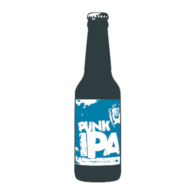
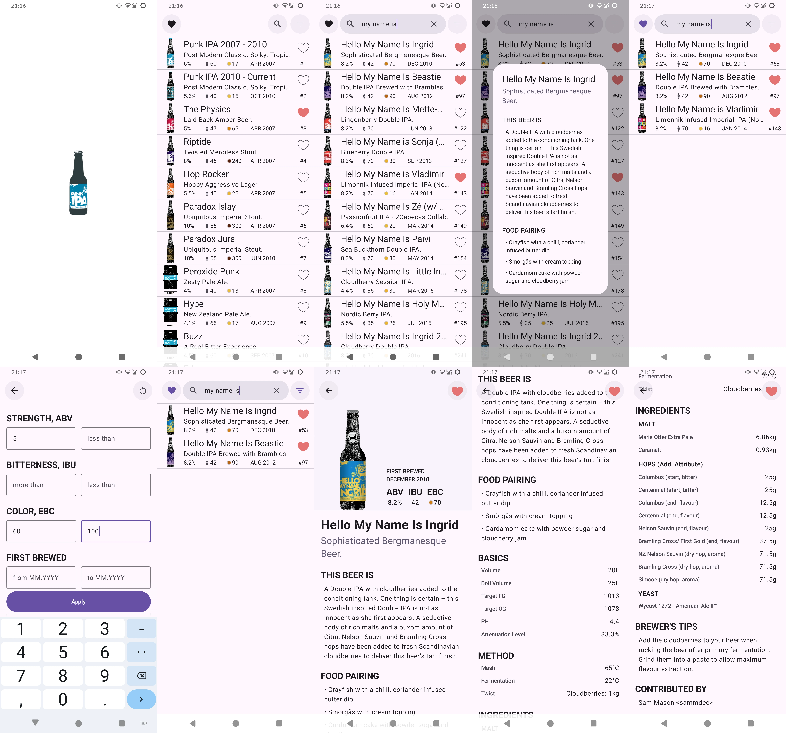

# PunkApp

A mobile catalog of BrewDog beers built around the [PunkAPI](https://github.com/alxiw/punkapi). Built with Clean Architecture and [Jetpack Compose](https://developer.android.com/compose), it pairs server-side filtering with [Paging 3](https://developer.android.com/topic/libraries/architecture/paging/v3-overview) and an offline-capable HTTP cache powered by [OkHttp](https://github.com/square/okhttp).

## Features

- 🍺 **Catalog** — browse the complete BrewDog beer lineup with infinite scrolling, EBC color markers, and a heart on every card
- 🎛️ **Filtering** — narrow the catalog in three ways that compose: by name through the search bar, by parameters in the Filters dialog, or by favorites with a tap of a heart
- ❤️ **Favorites** — heart any beer on the list or on its details page; the heart in the top bar is itself a filter that turns the catalog into a favorites-only view
- 👀 **Quick preview** — long-press a beer to read its description and food pairing without leaving the list
- 📖 **Beer details** — the full profile: brewing parameters, recipe breakdown, food pairings, and brewer's tips
- 💾 **Offline support** — API responses are cached on disk and images are cached by Coil, so loaded content stays available without a connection
- ✨ **Polished Compose UI** — shared element transitions between the list and details, edge-to-edge layout, and a back press that unwinds filters one layer at a time

## Overview

1. **Splash screen** — the app opens on the bottle logo while the catalog warms up.
2. **Catalog** — the beer list with images, ABV/IBU/EBC values, brew dates, and favorite hearts.
3. **Search** — the expanding top-bar field filters by name as you type; here `my name is` narrows the list to the "Hello My Name Is…" series.
4. **Quick preview** — long-press a beer to read its description and food pairing in a dialog over the list.
5. **Favorites** — the active heart in the top bar switches the list to favorited beers only while keeping the current search query.
6. **Filters** — a full-screen dialog with ABV, IBU, and EBC bounds, a first-brewed range, and a food phrase; the numeric keyboard is up for the EBC upper bound.
7. **Filtered results** — search, ABV, and EBC applied together leave only the beers that match every condition.
8. **Beer details** — the bottle, first-brewed date, ABV/IBU/EBC, description, and food pairing.
9. **Recipe** — basics, method, ingredients, hops, yeast, brewer's tips, and the contributor.

## Filtering

All filter controls converge on a single `BeersFilter` that the data layer receives, so the three sources compose: you can search by name inside a favorites-only list narrowed by ABV, and any change that actually alters the filter restarts paging with a new request.

- **By name** — the top-bar search stores the query in `SavedStateHandle`, debounces it for 300 ms, and sends it as the API's `beer_name` parameter.
- **By parameters** — the Filters dialog edits ABV, IBU, and EBC "more than / less than" bounds, a first-brewed date range (`MM.YYYY`), and a food-pairing phrase. Unset values stay `null` and are omitted from the request entirely.
- **By favorites** — the top-bar heart sets `favoritesOnly`. The repository snapshots the DataStore favorite ids once per `Pager` and passes them to the API's `ids` parameter, keeping the filter server-side. Toggling a heart on a card doesn't restart paging: the visible list reacts to the `favoriteIds` flow instead, and in favorites-only mode an un-hearted beer disappears immediately.

`distinctUntilChanged` drops filter emissions that would produce an identical request (e.g. applying the same filters twice), and an empty favorites snapshot yields an empty page without any network call.

## Architecture

The project follows **Clean Architecture** across four Gradle modules. Dependencies point inward: `:presentation` and `:data` depend only on `:domain`, and `:app` wires everything together. The data layer uses the **Repository pattern** to hide Retrofit, OkHttp, and DataStore behind a domain interface and feeds a **Paging 3** `PagingSource`; the presentation layer uses **MVVM with unidirectional data flow**.

### Modules

- **`:app`** — `Application` setup, Hilt entry points, `MainActivity` with the Compose navigation host, and the Coil `ImageLoader`.
- **`:domain`** — core models (`Beer` with its recipe sub-models, `BeersFilter`), the `BeersRepository` interface, and use cases (`GetBeersFlowUseCase`, `GetBeerUseCase`, `GetFavoriteIdsFlowUseCase`, `ToggleFavoriteUseCase`).
- **`:data`** — `BeersRepositoryImpl`, remote and local data sources, the Retrofit `BeersSearchService`, `BeerPagingSource`, OkHttp interceptors and cache, DataStore, Moshi response models and mappers, and Hilt modules.
- **`:presentation`** — ViewModels, `@Immutable` UI models, Compose screens and dialogs, and shared formatting helpers.

### Data Layer (Repository + Paging 3)

- **Repository pattern** — `BeersRepository` is declared in `:domain` and implemented by `BeersRepositoryImpl` in `:data`, bound with Hilt's `@Binds`. ViewModels never see Retrofit responses, DataStore preferences, or paging keys.
- **Two data sources** — `BeersRemoteDataSource` wraps the Retrofit service and translates `BeersFilter` into query parameters, while `BeersLocalDataSource` wraps a Preferences DataStore that stores favorite ids as a string set. `BeerResponse` → `Beer` mappers keep the API wire format out of the domain.
- **Server-side filtering** — the API does the actual filtering: name, ABV/IBU/EBC bounds, brew dates, food, and favorite `ids` all arrive as query parameters, so the app never filters a fully downloaded catalog in memory.
- **Paging** — `BeerPagingSource` loads fixed-size pages (`PAGE_SIZE` = 30), treats a short page as the last one, and returns `LoadResult.Error` for the UI to retry. `BeersRepositoryImpl` creates the `Pager`, and a changed `BeersFilter` creates a new `Pager` instead of patching the old one.
- **Offline-capable HTTP cache** — the Retrofit client has a bounded OkHttp disk `Cache` (up to 15 MB) and two interceptors. `OfflineFallbackInterceptor` switches to `only-if-cached` with a 28-day `max-stale` when there is no network or when the server returns an unusable payload, while `CacheControlInterceptor` gives successful JSON a 60-minute `max-age`, never stores error pages, and passes `304 Not Modified` through untouched. `NetworkHandler` checks connectivity.
- **Image cache** — Coil keeps images in its own 120 MB disk cache and a memory cache sized at 20% of RAM. It uses a separate OkHttp client (`@ImageHttpClient`) without the API cache policy, since Coil manages caching itself.
- **Favorites persistence** — DataStore Preferences is the single source of the favorite ids, so favorites survive process death and app restarts.

### Presentation (MVVM + UDF)

- **Single state holder** — `BeersViewModel` owns the screen state: a `Flow<PagingData<BeerItemUiModel>>` for the list, a `StateFlow<Set<Int>>` for favorites, and `StateFlow`s for the active filters. The screen renders those flows and sends user actions back as method calls, so data only flows one way.
- **Reactive filter pipeline** — the query, favorites toggle, and dialog filters are combined into one `BeersFilter`, passed through `distinctUntilChanged`, and mapped with `flatMapLatest` into `GetBeersFlowUseCase`; the resulting stream is `cachedIn(viewModelScope)` so pages survive recomposition.
- **Configuration changes** — the query and favorites-only flag live in `SavedStateHandle`, while the search text, focus, and dialog visibility are kept in `rememberSaveable`; the dialog's applied filters are held by the ViewModel. The search bar restores focus and keyboard visibility after rotation, and back presses unwind the state in order: search → filters → favorites.
- **Detail state** — `BeerDetailViewModel` exposes a sealed `BeerDetailUiState` (`Loading`, `Success`, `Error`) with a retry action, and updates the heart optimistically before persisting the toggle.
- **Compose UI** — Material 3 screens use `SharedTransitionLayout` for the beer image and name, edge-to-edge insets, a long-press preview dialog, and pagination load/error/empty states driven by `LazyPagingItems`.
- **UI models** — domain models are mapped to `@Immutable` `BeerItemUiModel` and `BeerDetailUiModel`; date formatting, EBC color calculation, and value/unit formatting stay in the presentation layer.

## Requirements

* Android Studio (a version that supports the required AGP)
* JDK 17 or newer
* [Android Gradle Plugin](https://developer.android.com/build/releases/about-agp) 9.5.1
* [Gradle](https://github.com/gradle/gradle) 9.9.0 (via `./gradlew`)
* `minSdk` 26, `compileSdk` 37, `targetSdk` 37

## Dependencies

* [Kotlin](https://github.com/JetBrains/kotlin) 2.4.21 with [KSP](https://github.com/google/ksp) 2.3.9
* [Jetpack Compose](https://developer.android.com/jetpack/compose) (BOM) 2026.09.00 with Material 3 and Material Icons Extended
* [Navigation](https://developer.android.com/guide/navigation) 2.10.2
* [Hilt](https://github.com/google/dagger) 2.60.1
* [Coroutines](https://github.com/Kotlin/kotlinx.coroutines) 1.11.0
* [Paging](https://developer.android.com/topic/libraries/architecture/paging/v3-overview) 3.5.3
* [Retrofit](https://github.com/square/retrofit) 3.0.0 and OkHttp 5.5.1 with the logging interceptor
* [Moshi](https://github.com/square/moshi) 1.15.2 (codegen via KSP)
* [DataStore](https://developer.android.com/topic/libraries/architecture/datastore) 1.3.0
* [Coil](https://github.com/coil-kt/coil) 2.7.0

Full list of versions: [`gradle/libs.versions.toml`](gradle/libs.versions.toml)

## Testing

* [JUnit](https://junit.org/junit5/) 6.1.3 (Jupiter)
* [Android JUnit 5](https://github.com/mannodermaus/android-junit5) 2.0.2 for instrumented tests
* AndroidX Test (runner) and Espresso

Unit tests cover the presentation formatting helpers (`DateFormatter`, `EbcColor`, `ValueUnit`, statistic values) and UI-model defaults.

Run unit tests:

    ./gradlew test

Run instrumented tests (requires a connected device or emulator):

    ./gradlew connectedAndroidTest

## License

[MIT](LICENSE) © [alxiw](https://github.com/alxiw)
